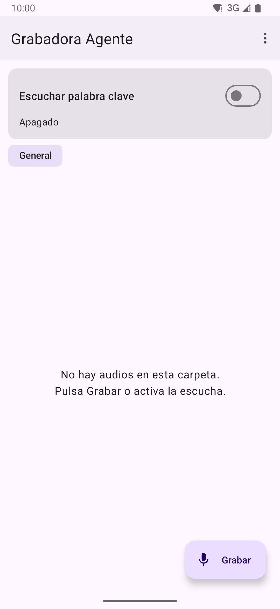
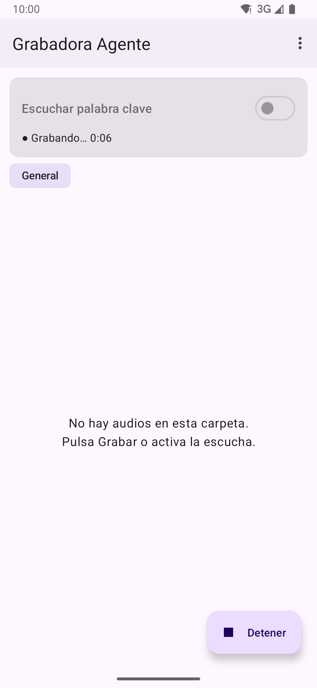
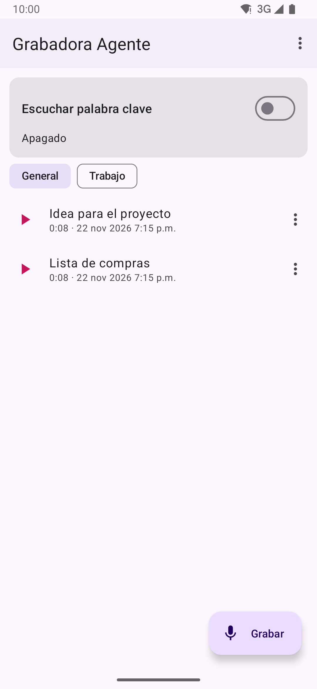
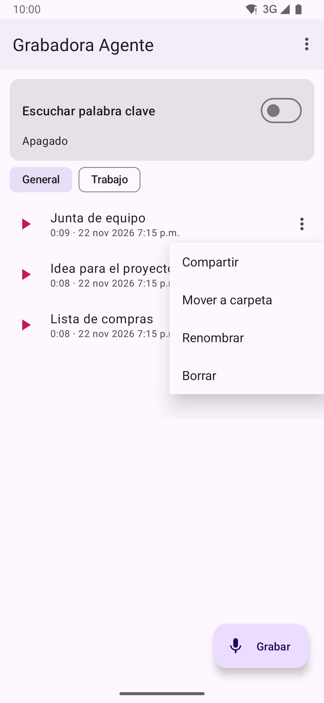
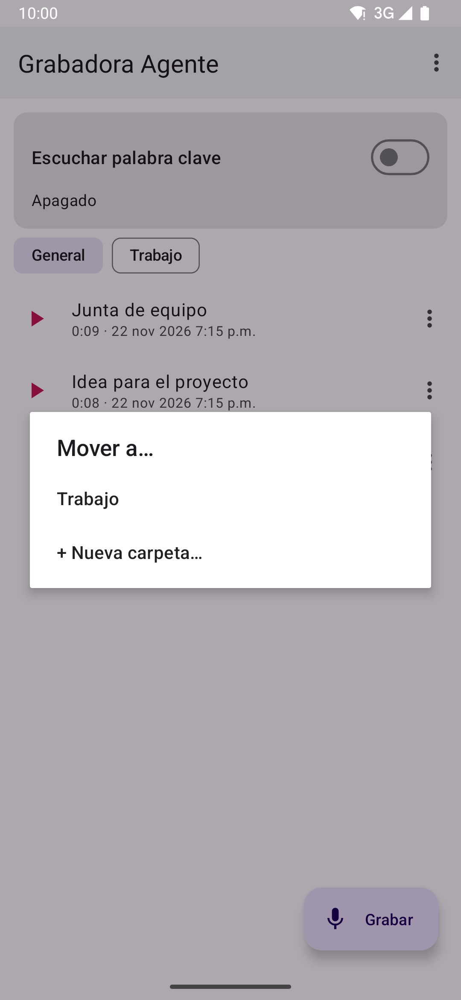
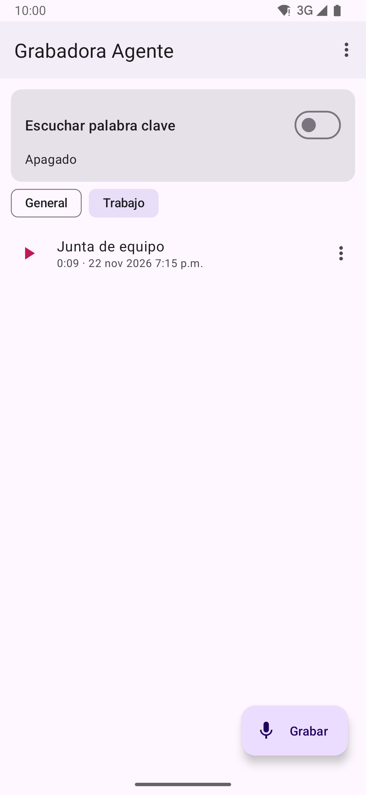
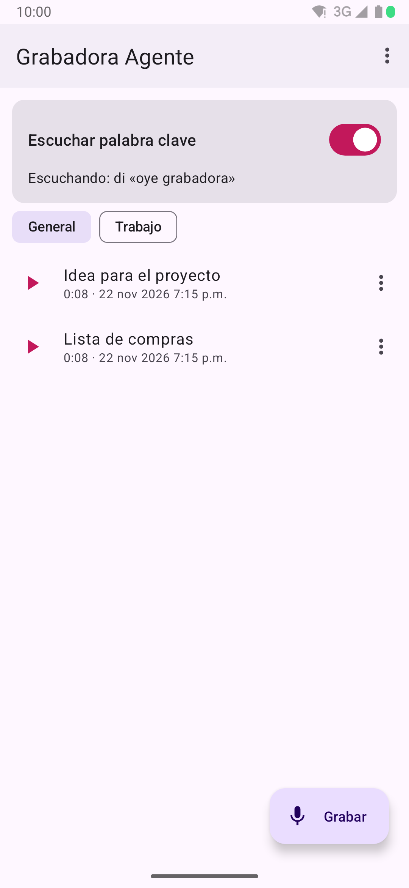
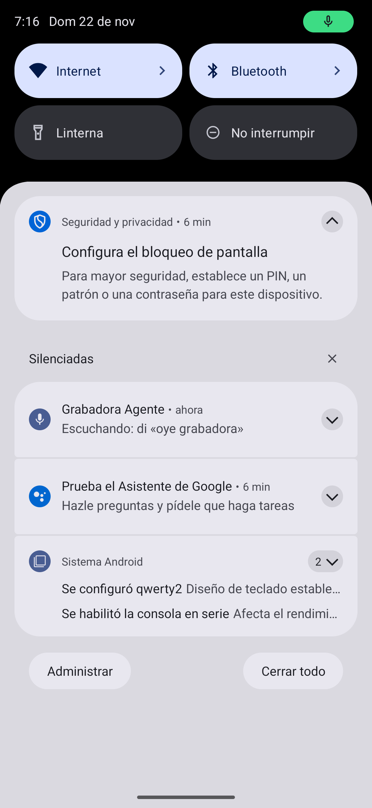
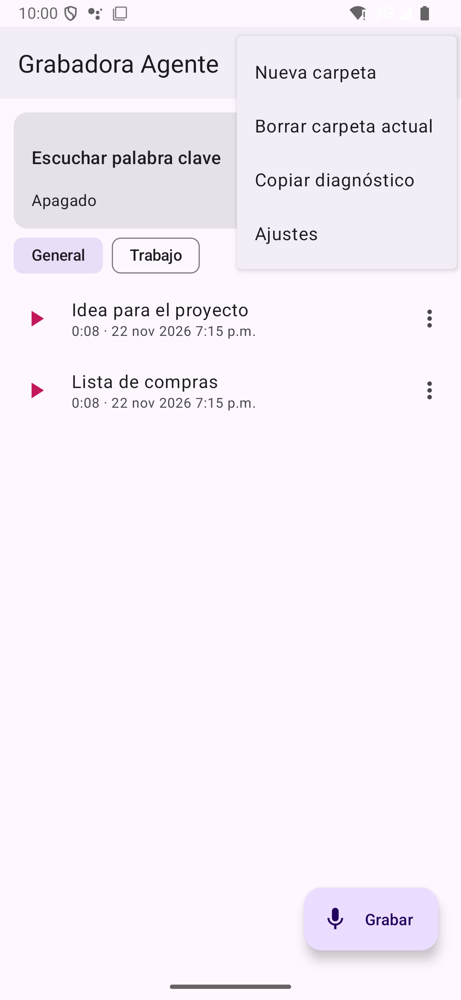
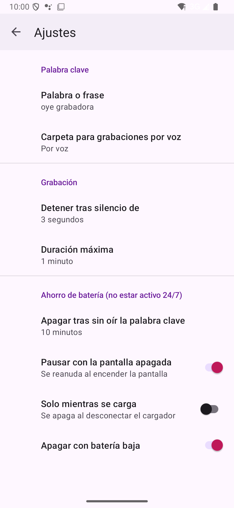

# Grabadora Agente — Documentación técnica

**Versión del código:** 0.4.1 (`versionCode 5`) · **Paquete:** `com.grabadora.agente` · **Actualizado:** 22-11-2026

Documento de referencia para quien mantenga la app. Para instalarla y usarla, ver [`README.md`](../README.md). Para las reglas de desarrollo, ver [`CONTRIBUTING.md`](../CONTRIBUTING.md). La versión formal en Word (APA) está en `docs/Documentacion-Grabadora-Agente.docx`: corresponde a la 0.4.1 e incluye las capturas (Figuras 1 a 3) y la revisión de código de la 0.4 (Tabla 11).

Las rutas de código son relativas a `app/src/main/java/com/grabadora/agente/`.

---

## 1. Qué es

App Android que graba audio, lo organiza en carpetas y puede activarse con una frase ("oye grabadora") **sin internet**, usando reconocimiento de voz local (Vosk). Su principio de diseño es **no estar activa 24/7**: solo escucha cuando el usuario la enciende y se apaga sola por inactividad, batería o cargador.

| Función | Dónde |
|---|---|
| Grabación manual (AAC en `.m4a`, 96 kbps, 44.1 kHz) | `record/Recorder.kt`, `ui/MainActivity.kt` |
| Carpetas reales en disco; mover, renombrar, borrar, compartir | `data/AudioRepository.kt` |
| Reproducción | `ui/MainActivity.kt` (`MediaPlayer`) |
| Modo agente: escucha la frase → graba → corta por silencio → vuelve a escuchar | `agent/KeywordService.kt` |
| Copia y verificación del modelo de voz | `agent/ModeloManager.kt` |
| Mosaico de ajustes rápidos | `agent/AgentTileService.kt` + `agent/ArmarActivity.kt` |
| Ajustes | `ui/SettingsActivity.kt`, `res/xml/preferencias.xml`, `agent/Prefs.kt` |

### 1.1 Versiones

| Campo | Valor |
|---|---|
| minSdk / targetSdk / compileSdk | 26 (Android 8.0) / 35 / 35 |
| AGP · Kotlin · Gradle | 8.7.3 · 2.0.21 · 8.10.2 |
| JDK para compilar | 17 o 21 (no 22+) |
| Vosk · JNA | `vosk-android` 0.3.47 · `jna` 5.13.0 |
| Modelo de voz | `vosk-model-small-es-0.42` (~58 MB en `assets/model-es/`, no versionado) |
| ABIs empaquetadas | `arm64-v8a`, `armeabi-v7a`, `x86_64` |
| Tamaño del APK debug | ~94 MB (0.3: ~104 MB) |

## 2. Pantallas

Capturas tomadas en el emulador (Android 15) con `scripts/capturas.py`.












---

## 3. Arquitectura

```
                 ┌──────────────────────────── AudioApp (Application) ─────────────────────────┐
                 │                         crea un único AudioRepository                         │
                 └───────────────┬──────────────────────────────────────┬──────────────────────┘
                                 │                                      │
     UI (hilo principal)         │                    Servicio en primer plano (tipo microphone)
 ┌───────────────────────────┐   │   cambios (LiveData)   ┌─────────────────────────────────────┐
 │ MainActivity              │◄──┴────────────────────────┤ KeywordService                      │
 │  · lista (ListAdapter)    │                            │  · Vosk SpeechService (palabra)     │
 │  · grabación manual       │  AgentState.info (LiveData)│  · Recorder (MediaRecorder)         │
 │  · reproducción           │◄───────────────────────────┤  · receptores: pantalla/batería/... │
 │  · hilo `io` (disco/SQL)  │                            │  · hiloModelo → ModeloManager       │
 └─────────────┬─────────────┘                            └──────────────▲──────────────────────┘
               │ interruptor                                             │ startForegroundService
               └─────────────────────────────────────────────────────────┤
 AgentTileService (mosaico) ──► ArmarActivity (invisible) ───────────────┘
```

| Capa | Paquete | Responsabilidad |
|---|---|---|
| Datos | `data/` | `Audio` (data class), `AudioDbHelper` (SQLite), `AudioRepository` (única puerta a disco + SQLite) |
| Grabación | `record/` | `Recorder`: envoltorio de `MediaRecorder`, amplitud para detectar silencio |
| Agente | `agent/` | Servicio, estado global, ajustes, modelo, mosaico |
| UI | `ui/` | Pantalla principal, adaptador de la lista, ajustes |

**Reglas de diseño que no se deben romper** (detalle en `CONTRIBUTING.md`):

1. **Un solo dueño del micrófono.** Vosk y `MediaRecorder` no pueden usarlo a la vez: el servicio llama a `detenerEscucha()` antes de grabar. La grabación manual se bloquea mientras `AgentState.activo` sea verdadero.
2. **Nada de 24/7:** `START_NOT_STICKY`, sin `BOOT_COMPLETED`, apagado por inactividad, batería y cargador.
3. **Android 14+:** el micrófono en primer plano solo arranca con la app visible; por eso el mosaico abre `ArmarActivity`.
4. **Toda operación de archivos pasa por `AudioRepository`**, que mantiene disco y SQLite sincronizados.

---

## 4. Modo agente

### 4.1 Máquina de estados

```
APAGADO ──► PREPARANDO ──► ESCUCHANDO ⇄ GRABANDO
                              ▲   │
                    pantalla  │   ▼ pantalla apagada
                           PAUSADO
cualquier estado ──► APAGADO  (usuario, inactividad, batería baja, cargador, error, modelo)
```

El estado vive en `AgentState.info` (LiveData) y lo leen la pantalla principal, el mosaico y la notificación.

### 4.2 Flujo paso a paso

1. **Activación.** Interruptor (`MainActivity.activarEscucha`), mosaico (`AgentTileService` → `ArmarActivity`; si el teléfono está bloqueado pide desbloquear primero) o notificación. Se piden `RECORD_AUDIO` y, en Android 13+, `POST_NOTIFICATIONS` (opcional). Si Android niega el servicio en primer plano, la app avisa en lugar de cerrarse.
2. **Arranque** (`onStartCommand`): `startForeground` con tipo `MICROPHONE`. Si ya estaba activo, se vuelve a llamar (lo exige Android tras cada `startForegroundService`). Si "Solo mientras se carga" está activo y no hay cargador, se apaga.
3. **Carga del modelo** en `hiloModelo` con `ModeloManager.cargar`. El resultado lleva un número de **generación**: si el agente se apagó o reinició mientras cargaba, el `Model` se cierra en vez de usarse (evita fugas de memoria nativa).
4. **Escucha.** Gramática cerrada de Vosk `["<frase>", "[unk]"]` a 16 kHz: solo reconoce la frase o "desconocido", lo que consume poco y casi no da falsos positivos.
5. **Detección.** Se busca la frase como **palabras completas** (expresión regular con límites de espacio), no como subcadena.
6. **Grabación.** Se libera el micrófono, se fija la carpeta de destino (`carpetaGrabacion`) y arranca `MediaRecorder`.
7. **Vigilancia** cada 250 ms: si la amplitud supera 1500 (de 32767) hay voz. Corta tras `segundos_silencio` sin voz (y al menos 1.5 s de grabación) o al llegar a `segundos_maximo`. También se puede cortar desde la notificación o el botón de la pantalla.
8. **Cierre.** Se registra el audio en la carpeta fijada al empezar y se vuelve a escuchar (o a pausa si la pantalla está apagada).
9. **Apagado** (`apagar` → `liberar`): guarda la grabación en curso, detiene Vosk, cierra el modelo, quita receptores y notificación.

### 4.3 Apagado y pausa automáticos

| Evento | Condición | Efecto |
|---|---|---|
| `ACTION_SCREEN_OFF` | `pausar_pantalla_apagada` | Pausa (si está grabando, termina primero) |
| `ACTION_SCREEN_ON` | estaba pausado por pantalla | Vuelve a escuchar |
| `ACTION_BATTERY_LOW` | `parar_bateria_baja` | Apaga |
| `ACTION_POWER_DISCONNECTED` | `solo_cargando` | Apaga |
| Temporizador | `minutos_inactividad` > 0 sin grabar por voz | Apaga (también corre durante la pausa por pantalla) |
| Error de Vosk o del modelo | — | Apaga con el motivo visible en la tarjeta |

### 4.4 Modelo de voz (`ModeloManager`)

- Copia `assets/model-es` a `filesDir/model-es` (respaldo: almacenamiento externo de la app).
- **Copia atómica:** escribe en `model-es.tmp`, verifica el tamaño de cada archivo contra el APK y solo entonces renombra. El `uuid` se copia al final.
- Revisa el espacio libre antes de copiar (tamaño del modelo + 10 MB).
- Si Vosk no abre la copia, la borra, copia de nuevo y reintenta una vez. Los errores de librería nativa (`LinkageError`) se reportan como "teléfono incompatible".
- Borra la carpeta `model` que dejaba la versión 0.1.

---

## 5. Datos

### 5.1 SQLite — `audios.db` (versión 1)

```sql
CREATE TABLE audios (
    _id      INTEGER PRIMARY KEY AUTOINCREMENT,
    nombre   TEXT    NOT NULL,   -- nombre del archivo sin extensión
    ruta     TEXT    NOT NULL,   -- ruta absoluta del .m4a
    carpeta  TEXT    NOT NULL,   -- nombre de la carpeta (no hay tabla de carpetas)
    duracion INTEGER NOT NULL,   -- milisegundos
    fecha    INTEGER NOT NULL,   -- epoch ms al registrarse
    por_voz  INTEGER NOT NULL DEFAULT 0
)
```

**Migraciones:** `onUpgrade` ya no borra la tabla. Al subir la versión hay que agregar un paso por versión (`if (oldVersion < 2) ALTER TABLE ...`). Borrar la tabla dejaría los `.m4a` en disco sin registro e invisibles.

### 5.2 Disco

```
Android/data/com.grabadora.agente/files/Music/Grabaciones/
├─ General/                 siempre existe; no se puede borrar
├─ Por voz/                 carpeta por defecto del modo agente
└─ <carpetas del usuario>/
   ├─ Grabacion_2026-11-22_18-30-00.m4a
   └─ Grabacion_2026-11-22_18-30-00 (2).m4a   ← mismo segundo, o al mover/renombrar
```

Respaldo si no hay almacenamiento externo: `filesDir/Grabaciones/`. `res/xml/file_paths.xml` cubre ambas rutas para `FileProvider`.

### 5.3 Reglas del repositorio

| Operación | Comportamiento |
|---|---|
| Nombres válidos (carpeta, archivo, carpeta de voz) | No vacíos, ≤ 100 caracteres, sin empezar por `.`, sin `\ / : * ? " < > \|` ni caracteres de control |
| `nuevoArchivo` | `Grabacion_<fecha-hora>.m4a`; si existe, agrega ` (2)`, ` (3)`… |
| `mover` | `renameTo`; si falla, copia y borra. Si la copia o el borrado fallan, elimina la copia (nunca quedan dos) |
| `renombrar` | Nunca sobrescribe |
| `borrar` | Si el archivo existe y no se pudo borrar, conserva el registro |
| `borrarCarpeta` | Solo vacías y nunca `General` |
| `listar` | Quita (en una transacción) los registros cuyo archivo ya no existe |
| `cambios` | Contador atómico en LiveData; la UI se refresca al cambiar |

---

## 6. Manifiesto y permisos

| Permiso | Para qué |
|---|---|
| `RECORD_AUDIO` | Grabar y escuchar la frase (se pide en tiempo de ejecución) |
| `POST_NOTIFICATIONS` | Notificación fija del servicio (Android 13+; opcional) |
| `FOREGROUND_SERVICE` + `FOREGROUND_SERVICE_MICROPHONE` | Servicio en primer plano de tipo micrófono |

**No hay permiso `INTERNET`:** la app no puede enviar datos por red.

| Componente | exported | Notas |
|---|---|---|
| `ui.MainActivity` | sí | Launcher, `singleTop` |
| `ui.SettingsActivity` | no | |
| `agent.ArmarActivity` | no | Translúcida, `noHistory`, fuera de recientes |
| `agent.KeywordService` | no | `foregroundServiceType="microphone"` |
| `agent.AgentTileService` | sí | Protegido con `BIND_QUICK_SETTINGS_TILE` |
| `FileProvider` | no | `${applicationId}.fileprovider`, solo carpetas `Grabaciones/` |

**Respaldo:** `allowBackup="false"` y `res/xml/data_extraction_rules.xml` excluye todo. Las grabaciones, la base y el modelo no se suben a la nube ni pasan a otro teléfono.

---

## 7. Ajustes

| Clave | Defecto | Efecto |
|---|---|---|
| `palabra_clave` | `oye grabadora` | Frase de activación (se normaliza a minúsculas). Debe existir en el vocabulario del modelo; si no, Vosk la ignora sin avisar |
| `carpeta_voz` | `Por voz` | Carpeta de las grabaciones por voz. Si el texto no es un nombre válido, se usa `Por voz` |
| `segundos_silencio` | 3 (2, 3, 5, 10) | Silencio que corta la grabación por voz (mínimo 1) |
| `segundos_maximo` | 60 (30, 60, 300, 900) | Duración máxima por grabación (mínimo 5) |
| `minutos_inactividad` | 10 (5, 10, 30, 60, 0 = sin límite) | Apagado por no oír la frase |
| `pausar_pantalla_apagada` | sí | Pausa con la pantalla apagada |
| `solo_cargando` | no | Solo funciona con cargador |
| `parar_bateria_baja` | sí | Apaga con batería baja |
| `carpeta_actual` | `General` | Carpeta seleccionada en la pantalla (interno, no aparece en Ajustes) |

---

## 8. Compilar y publicar

```bash
python3 scripts/capturas.py                       # regenera las capturas de docs/capturas/
export JAVA_HOME=/opt/homebrew/opt/openjdk@17     # macOS con Homebrew
./gradlew assembleDebug                           # app/build/outputs/apk/debug/app-debug.apk
./gradlew lintDebug                               # debe terminar sin errores
adb install -r app/build/outputs/apk/debug/app-debug.apk
adb logcat -s KeywordService ModeloManager        # registros del agente y del modelo
```

El modelo se descarga con `scripts/descargar-modelo.ps1` (PowerShell) a `app/src/main/assets/model-es/`. Sin modelo la app compila, pero el modo agente avisa que falta y se apaga.

Los APK se publican en **Releases** de GitHub (no en el repo: `apk/` y `*.apk` están en `.gitignore`). Es una build *debug* firmada con clave de depuración: sirve para probar, no para Google Play.

---

## 9. Revisión de código (22-11-2026)

Se revisaron los 14 archivos Kotlin, el manifiesto y los recursos. Resultado: `assembleDebug` y `lintDebug` pasan; lint solo deja 3 avisos menores que ya existían (`ObsoleteSdkInt`, `Overdraw`, `SetTextI18n`).

### 9.1 Corregido en 0.4

| # | Área | Problema | Corrección |
|---|---|---|---|
| 1 | Privacidad | `allowBackup="true"`: grabaciones, base y ajustes podían subirse al respaldo en la nube | `allowBackup="false"` + `data_extraction_rules.xml` |
| 2 | Seguridad | `carpeta_voz` sin validar: `../x` o `a/b` creaban directorios fuera de `Grabaciones/` | Validación con `AudioRepository.nombreValido`; si no es válido, `Por voz` |
| 3 | Estabilidad | `ArmarActivity` (y el interruptor) se cerraban si Android negaba el servicio en primer plano | `try/catch` con aviso al usuario |
| 4 | Memoria | Apagar mientras cargaba el modelo dejaba el `Model` nativo sin cerrar | Contador de generación; `liberar` ya no borra todos los mensajes del `Handler` |
| 5 | Datos | La carpeta de voz se leía al empezar y al terminar: si cambiaba a medias, archivo y registro quedaban separados | Se fija en `carpetaGrabacion` al empezar |
| 6 | Datos | Dos grabaciones en el mismo segundo se sobrescribían | `nuevoArchivo` usa `archivoLibre` |
| 7 | Datos | `onUpgrade` borraba la tabla y dejaba todos los audios invisibles | Sin borrado; plantilla de migraciones |
| 8 | Datos | `borrar` quitaba el registro aunque el archivo no se borrara; `mover` podía dejar copia duplicada | Ambos verifican el resultado y limpian |
| 9 | Rendimiento | Disco y SQLite en el hilo principal en cada refresco; `notifyDataSetChanged` redibujaba todo | Hilo `io` + `ListAdapter`/`DiffUtil`; `MediaPlayer.prepareAsync` |
| 10 | Concurrencia | `AgentState.activo` podía leer un valor viejo (`postValue`) | Asignación inmediata en el hilo principal |
| 11 | Concurrencia | Contador `cambios` no atómico | `AtomicInteger` |
| 12 | Robustez | `Recorder.iniciar` dos veces filtraba un `MediaRecorder` | `check(!grabando)` |
| 13 | Detección | `contains` disparaba con subcadenas | Coincidencia por palabras completas |
| 14 | UX | El mosaico con el teléfono bloqueado no abría nada | `unlockAndRun` |
| 15 | Tamaño | El APK traía librerías para `armeabi`, `mips`, `mips64`, `x86` | `abiFilters`: 104 → 94 MB |
| 16 | Notificación | Sin categoría; Android podía retrasarla hasta 10 s | `CATEGORY_SERVICE` + `FOREGROUND_SERVICE_IMMEDIATE` |
| 17 | Limpieza | Cadena `pref_palabra_resumen` sin uso | Eliminada |

### 9.2 Pendiente (no se cambió)

| Riesgo | Detalle | Sugerencia |
|---|---|---|
| Sin probar en teléfono la 0.4 | Los cambios compilan y pasan lint, pero no se probaron en un dispositivo | Probar: activar y apagar enseguida, mosaico bloqueado, mover entre carpetas, borrar con lista larga |
| Inicio del habla perdido | Entre detectar la frase y arrancar `MediaRecorder` pasan unos cientos de ms sin grabar | Grabar con `AudioRecord` compartido con Vosk (cambio grande) |
| Umbral de silencio fijo | 1500 de 32767: en lugares ruidosos nunca detecta silencio y llega al máximo | Ajuste de sensibilidad o umbral adaptativo |
| Archivos huérfanos | Si el proceso muere grabando, el `.m4a` queda sin registro (y puede estar dañado) | Al abrir, registrar `.m4a` sin fila o borrarlos |
| Audios sin cifrar | En Android 8–10, apps con permiso de almacenamiento pueden leer `Android/data` | Mover a `filesDir` si se requiere confidencialidad |
| Pausa e inactividad | Con la pantalla apagada (pausa por defecto) el temporizador sigue y apaga el agente | Decidir si la pausa debe detener el temporizador |
| Vocabulario de la frase | Una palabra fuera del vocabulario se ignora sin avisar | Validar la frase contra el modelo en Ajustes |
| Sin tests ni firma de release | Solo build debug; sin minificación (JNA usa reflexión) | Tests de `AudioRepository`; keystore de release; reglas ProGuard para JNA/Vosk |
| Descarga del modelo sin checksum | `descargar-modelo.ps1` no verifica el zip | Comparar SHA-256 publicado |

---

## 10. Problemas comunes

| Síntoma | Causa probable | Qué hacer |
|---|---|---|
| "Falta el modelo de voz" | Se compiló sin `assets/model-es` | Ejecutar `scripts/descargar-modelo.ps1` y recompilar |
| "Android no permitió iniciar la escucha" | Se intentó arrancar con la app en segundo plano (Android 12+) | Abrir la app y usar el interruptor |
| No reacciona a la frase | Ruido, distancia o palabra fuera del vocabulario | Hablar cerca; probar otra frase de 2–3 palabras comunes |
| Se apaga sola | Inactividad, batería baja o cargador | Es lo esperado; el motivo aparece debajo del interruptor |
| "Apaga la escucha antes de grabar a mano" | El micrófono solo tiene un dueño | Apagar el interruptor |
| El modelo falla al abrir | Copia dañada o teléfono sin soporte nativo | Botón **Reintentar**; si sigue, **⋮ → Copiar diagnóstico** |

---

## 11. Historial

| Versión | Fecha | Cambios |
|---|---|---|
| 0.1 | 10-11-2026 | Primera versión: grabación, carpetas, modo agente con `StorageService` de Vosk |
| 0.3 | 16-11-2026 | `ModeloManager` (copia atómica, verificación, reintento), diagnóstico, botón para cortar la grabación por voz |
| 0.4.1 | 22-11-2026 | La hora y la batería de la barra de estado no se veían en tema claro (íconos blancos sobre fondo claro en Android 15); capturas automáticas con `scripts/capturas.py` |
| 0.4 | 22-11-2026 | Revisión de código: privacidad del respaldo, validación de carpeta de voz, fugas y carreras del servicio, E/S fuera del hilo principal, APK más ligero (ver sección 9.1) |
